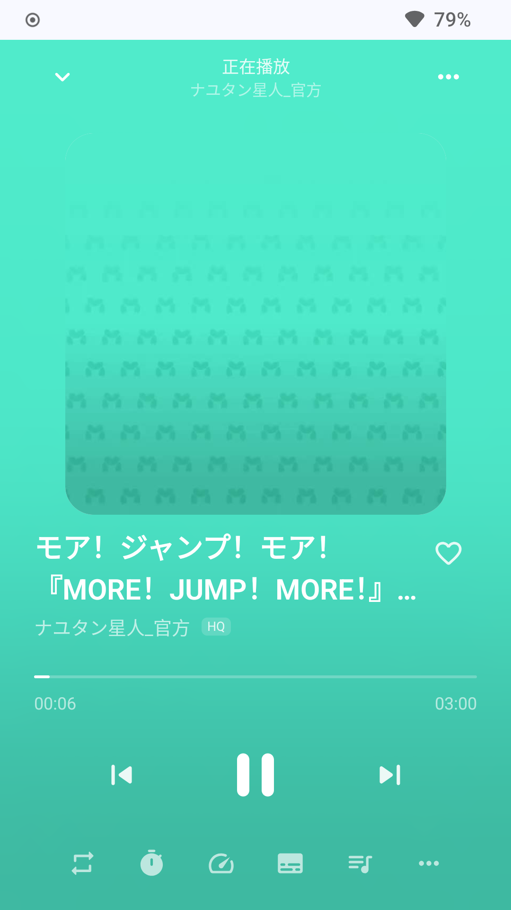
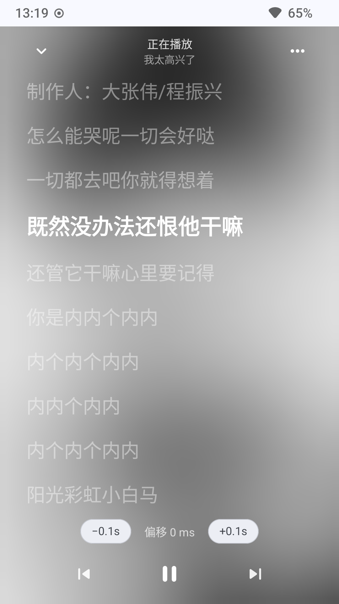
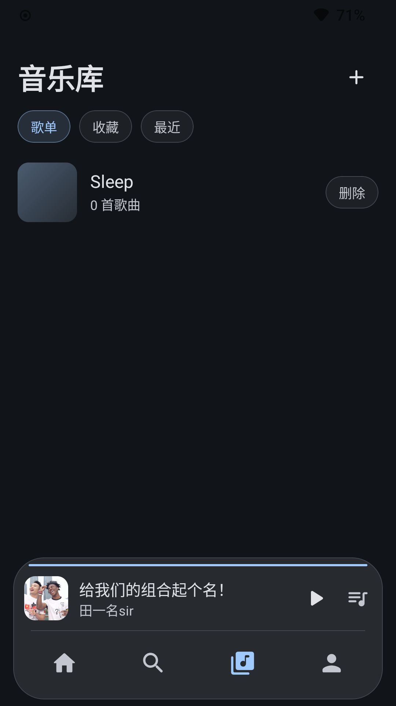
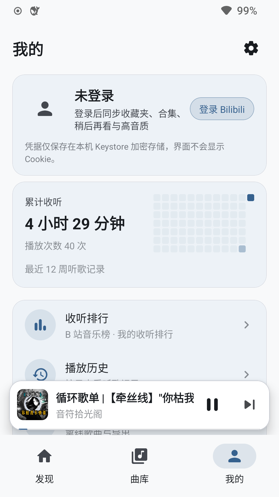
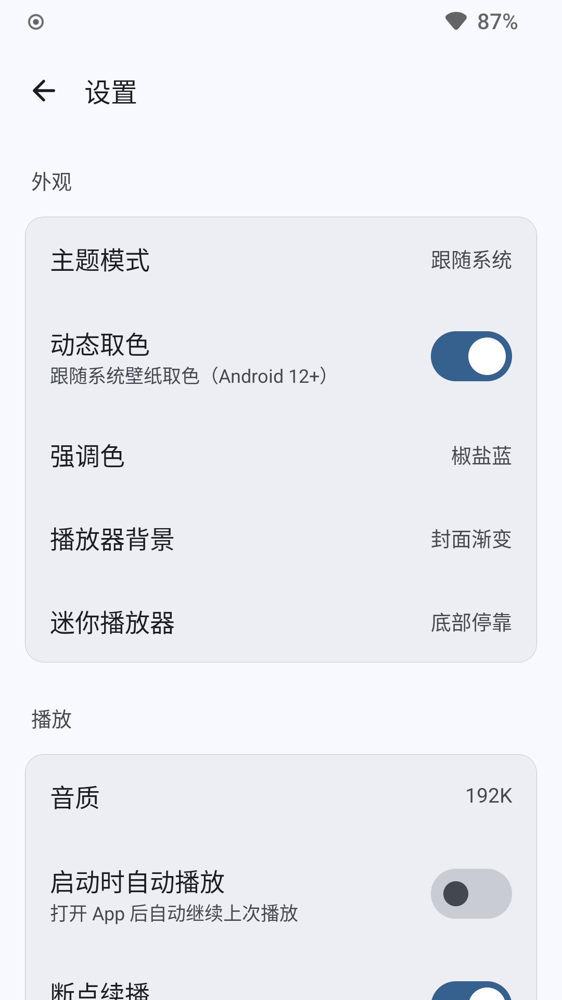

# BBPlayer · 安卓原生版

[](https://github.com/small-ora/bbplayer-android/actions/workflows/android.yml)
[](https://github.com/small-ora/bbplayer-android/releases)

用 **Kotlin + Jetpack Compose** 重写的 [BBPlayer](https://github.com/bbplayer-app/bbplayer)（B 站音频播放器）核心体验。
界面与组件风格参考 **[椒盐音乐 Salt Player](https://github.com/Moriafly/SaltPlayerSource)**，直接基于其开源的 SaltUI 组件库（`io.github.moriafly:salt-ui`）。

> 本项目为学习/研究性质的第三方客户端，与 Bilibili 官方无关；数据来自 B 站公开接口，仅供个人听歌使用，请遵守 B 站用户协议。

## 功能

### v8.2 修复（搜索只显示一条结果）

- **修复搜索只出来一个结果**：此前搜索页对所有输入都先走「单视频解析」，而它对普通关键词只取第一条视频展开分 P，导致搜「小虎队」等关键词永远只有 1 条结果。现在关键词走搜索列表接口（首页 20 条/页），BV 号 / av 号 / b23.tv 短链 / 完整视频链接仍走单视频解析（含分 P），解析失败再回退列表搜索
- 输入解析器从 `data` 移到 `core` 供数据层与 UI 共用，新增搜索路由回归单测
- 版本 0.8.2（versionCode 15）

### v8.1 修复（系统手势条区域的「小白条」透内容）

- **修复底部手势条（小白条）下方透出页面内容**：部分手机的系统手势条 inset 较大时，底部导航栏/迷你播放器下方的 inset 区域是透明的，列表内容会从手势条下面透出来。现在整条底部 chrome（含手势条 inset）都会铺上主题背景色，内容不再穿帮
- 宽屏悬浮迷你播放器的 inset 区域同步处理
- 版本 0.8.1（versionCode 14）

### v8 新增（底部导航 / 悬浮迷你播放器 / 全应用 UI 重构）

- **底部 3 Tab 导航**：废弃左侧抽屉与汉堡菜单，改为「发现 / 曲库 / 我的」底部导航栏（避让系统手势条）；进入二级页时底栏下滑隐藏，迷你播放器下沉贴底常驻
- **悬浮胶囊迷你播放器**：悬浮在底部导航正上方（左右 12dp、16dp 圆角、64dp 高）；40dp 封面 + 单行跑马灯标题 + UP 主；右侧仅播放/暂停与下一首（48dp 热区）；底部内置 2dp 进度条；点按/上滑平滑展开全屏播放器，保留左右滑切歌
- **发现页**：去掉「发现音乐」大标题与收听统计卡，顶部改为 Material 3 SearchBar（占位「搜索音乐 / BV号 / 链接」）；最近播放与收藏视频卡改为 16:9 封面、12dp 圆角、标题最多 2 行
- **曲库页**：歌单行 [播放][重命名][删除] 三胶囊收敛为 MoreVert + M3 底部操作弹层（立即播放 / 重命名 / 批量管理 / 删除）；批量管理支持多选与二次确认删除；无悬浮 FAB，功能操作收敛顶部
- **我的页**：累计收听时长、播放次数、12 周听歌热力图合并为一张仪表板卡片（左指标右紧凑点阵）；收听排行 / 播放历史 / 已下载 / 导入歌单统一为「圆形浅色图标底托 + Chevron」的 ripple 列表卡；设置入口移至右上角齿轮
- **全屏播放器**：封面放大至屏宽的 82%–85%（16dp 圆角、高斯模糊背景衬托、无白边高光）；标题单行跑马灯 + 右侧常驻红心；副标题为 UP 主 + 音质标签；主播放键放大为 72dp + 半透明圆形底板；底部功能栏 `navigationBarsPadding` 避让系统手势条
- **视觉规范**：Material You 动态取色；浅色背景 `#F8F9FA`、卡片表面 `#EDF2F7`、卡片圆角统一 16dp、字阶 20sp Bold / 14sp / 12sp（60% 灰）；深色与纯白主题同步回归
- 全量门禁（app assemble + data/playback/lyrics 单测）通过；版本 0.8.0

### v7.4 新增（首页模块化 / 最近播放歌单 / 菜单精简）

- **首页新增「最近播放的歌单」**：记录歌单最近一次播放时间，用 2×2 封面拼图 + 歌单名 + 「N 首 · 最近播放」展示；点击进入歌单
- **首页内容多样化**：最近播放（单曲，已去重）、最近播放的歌单（无记录时显示「我的歌单」）、我的收藏、收听统计、B 站音乐区热门（只展示前 6 首 + 「完整榜单」入口，不再占满整页）
- **菜单去掉重复的「搜索」**：首页已有搜索框；搜索页仍可从首页搜索框进入（保留底部迷你播放器）
- 「最近播放」单曲按歌曲去重，避免同一首歌重复出现多张卡

### v7.3 新增（评论页融合 / 迷你播放器手势 / 纯白主题 / 风格统一）

- **评论页融入播放器背景**：播放页第 3 页不再是一块纯白卡片，改为透明底 + 白色文字（深色渐变时加轻微压暗保证可读）；纯白墨水屏播放页自动切深色文字
- **迷你播放器优化**：去掉右侧「播放队列」按钮（点击整条即进入播放页）；支持**左滑下一首、右滑上一首**
- **新增「纯白」主题**：设置 → 外观 → 主题模式 → 纯白，全局纯白背景 + 黑色文字（更纯净）；纯白主题下隐藏不生效的「动态取色 / 强调色」项
- **设计风格统一**：设置页长说明行（凭据安全）不再被挤成竖排；纯白主题下徽章/卡片/文字对比度修正；播放页歌词/评论随纯白背景自适应深色文字

### v7.2 新增（播放页横滑收敛 / 状态栏连贯 / 备份修复）

- **横滑只作用于内容区**：播放页只有「歌名上方的内容区」左右滑动切换封面 / 歌词 / 评论；歌名、进度条、播放控制、底部操作行固定不动
- **去掉播放控件下的「歌词」按钮**：歌词只通过横向滑动进入
- **状态栏 edge-to-edge 连贯**：播放页背景延伸到状态栏/导航栏下方（不再有独立色带），其它页面内容自动避让状态栏；状态栏图标颜色跟随界面（亮色页深图标、深色页亮图标、纯白墨水屏播放页深图标）
- **修复「导出备份」无反应**：备份 zip 之前因 FileProvider 路径未开放而分享失败（且提示在屏幕外）；现在会弹出系统分享面板并用 Toast 提示文件已生成
- 版本 0.7.2

### v7.1 修复（安装 / 签名）

- **固定发布签名**：从 v0.7.1 起，GitHub Release 只提供用固定 release keystore 签名的 `app-release.apk`（包名 `com.bbplayer.android`），后续版本可直接覆盖升级，不再出现「与已安装应用签名不同」
- **旧版本迁移（一次性）**：v0.7.0 及更早 Release 里是调试签名 APK（包名 `com.bbplayer.android.debug`，且每次 CI 构建签名都不同）与未签名 release，无法直接覆盖升级。迁移步骤：旧版「设置 → 数据 → 导出备份」→ 安装新版 `app-release.apk` → 新版「设置 → 数据 → 从备份恢复」（两个包名不同，可共存，也可确认数据迁移后卸载旧版）
- **CI 签名校验**：构建流水线用仓库 secrets 解码 keystore 签名 release APK，并用 `apksigner verify` 校验证书

### v7 新增（播放页三页横滑）

- **播放页横滑**：进入播放页默认「封面」页，左滑依次切换到「歌词」「评论」，右滑反向；顶部 3 点页码指示
- **歌词页纯展示**：不再提供 ±0.1s / 偏移数值调整按钮；点歌词行仍可跳转到对应播放位置
- **歌词偏移统一在设置**：设置 → 歌词 → 歌词偏移（±100ms，范围 -2000~2000ms）；旧版已保存的逐曲偏移仍会叠加生效
- **评论内嵌播放页**：评论分页 / 楼中楼 / 加载更多在播放页第 3 页直接浏览；滑走再滑回保持已加载内容与滚动位置，且只有滑到评论页才发起请求
- **手势细节**：进度条拖动优先于翻页（不会误切页）；纯白墨水屏主题下页码指示与顶部栏自动转深色

### v6 新增（侧边栏导航 / 底栏播放控件 / 设置精简）

- **导航改为侧边栏**：底栏导航取消，左上角汉堡打开左侧抽屉（首页 / 搜索 / 音乐库 / 我的 + 排行榜 / 收听历史 / 已下载 / 导入歌单 / 设置）；宽屏（≥600dp）保持左侧常驻导航栏
- **底栏改为纯音乐控件**：封面 / 标题 / 歌手 / 进度线 / 上一首 / 播放暂停 / 下一首 / 队列；无曲目自动隐藏；保留「底部停靠 / 悬浮胶囊」两种样式；抽屉打开时底栏压在遮罩之下，支持点遮罩或返回键关闭
- **设置项去重**（同一偏好只保留一个入口）：音质与「高音质」开关合并为单一「音质」下拉（杜比 / 无损需登录）；「启动时自动播放」+「断点续播」合并为「启动时」三选一；导入每批数量只在导入页调整；接口缓存与歌词缓存合并为一个「清除缓存」；我的页去掉与「设置」重复的「主题与外观」入口

### v5 新增（登录体系）

- **B 站账号**：扫码登录（二维码由 App 生成并轮询）+ 手动 Cookie 粘贴；登录状态跨重启保持；可随时退出
- **凭据安全**：Android Keystore AES-GCM 加密存本地，不打印 Cookie、不上传第三方；退出即清除；接口缓存按登录账号隔离
- **收藏夹**：收藏夹列表与内容播放、播放页「收藏到 B 站收藏夹」（多选）、是否已收藏
- **合集 / 系列**：我的合集列表与内容播放
- **稍后再看**：列表、加入、移除、清空
- **UP 主主页**：资料/粉丝数、视频列表、关注/取关（WBI 签名）
- **高音质**：登录后在「设置 → 音质」中选择 Hi-Res 无损 / 杜比全景声（无权限自动回退最高 AAC）
- **隐私**：可选「上报播放进度到 B 站历史」，默认关闭

### v4 新增（导入续跑 / 歌词偏好）

- **歌单导入可暂停 / 续跑 / 分批**：任务持久化到本地，重启 App 后从断点继续；每批 20/50/100/200 首可调，每批落盘；命中 B 站 `-412` 自动停止并显示冷却倒计时，已匹配进度不丢
- **歌词来源偏好**：自动（QQ→网易云）/ QQ 优先 / 网易云优先，随设置即时生效
- **旧缓存补逐字**：v3 之前缓存的纯 LRC 歌词会自动补估算逐字时间轴（一次升级写回，无需手动清缓存）

### v3 新增（缓存 / 逐字 / 元数据）

- **接口缓存与限流**：搜索、详情、分 P、playurl、榜单、相关、联想/热搜、评论、字幕、外部歌单、更新检查统一缓存（TTL + LRU + 磁盘持久化，`filesDir/api_cache`）；同 key 并发合并；**请求节流 350ms±抖动**；命中缓存不再发请求；错误不缓存；设置 → 缓存可查看/清除
- **风控保护**：命中 B 站 `-412` 后全局冷却 60 秒并给出友好提示；歌单批量匹配改为 1200ms±抖动、失败 30s 退避、连续风控自动中止
- **真实逐字歌词**：QQ 音乐 QRC（hex 密文 → QQ 私有 Triple-DES 变体 + zlib）、网易云 YRC；无逐字时按行均匀估算并标记 `:estimated`，UI 逐字渐变对普通 LRC 也生效
- **导出元数据**：导出的 `.m4a` 嵌入标题/艺术家/专辑/歌词/封面（MP4 iTunes atoms），保留原始标签，尾部数据原样复制不破坏播放

### v2 新增（非登录功能补齐）

- **下载与离线**：歌曲下载（Range 断点续传、并发 1–3）、下载管理（进行中/已完成/失败、取消/删除/清空）、**无网络播放已下载曲目**、导出到 `Music/BBPlayer`（附同名 `.lrc`）
- **外部歌单导入**：粘贴网易云 / QQ 音乐歌单链接或 ID → 解析歌单 → 逐曲匹配 B 站视频（限速、进度、匹配度、时长差）→ 可手动替换 → 保存为本地歌单
- **评论**：一级评论分页 + 楼中楼回复（只读，无需登录）
- **发现**：搜索联想词、B 站热搜、B 站音乐区排行榜 / 我的收听排行、按日收听历史
- **播放器与外观**：播放器背景（封面渐变 / 纯色 / **纯白墨水屏**）、迷你播放器（底部停靠 / 悬浮胶囊）、**强调色预设**、保留动态取色与深浅色
- **歌词增强**：逐字渐变渲染（SPL / 增强 LRC / YRC / QRC 解析）、**逐曲偏移持久化**、现代/经典两种样式、翻译开关、**桌面歌词悬浮窗**（拖动/字号/颜色/锁定）、**通知栏歌词行**、**歌词分享卡片**
- **其他**：本地备份/恢复（zip，含设置）、GitHub Releases 更新检查、播放队列保存为歌单、歌单排序与站内过滤

### v1 核心功能（仍保留）

- **发现**：B 站音乐区热门榜单、最近播放、下拉/点击刷新
- **搜索**：关键词、BV 号、av 号、`b23.tv` 短链、完整视频链接；最近搜索记录与清空
- **播放**：B 站匿名音频流（DASH，默认最高可用档）；后台播放 / 媒体通知 / 锁屏与蓝牙控制；队列、播放模式（顺序/列表循环/单曲循环/随机）、倍速、拖动进度、定时关闭、断点续播（启动恢复队列与进度）
- **歌词**：LRC / 增强 LRC / SPL / YRC / QRC 解析、逐行高亮 + 逐字渐变 + 自动居中滚动、翻译合并、在线获取（QQ 音乐 → 网易云）、手动搜索候选、粘贴 LRC、逐曲偏移、字号/样式/翻译开关
- **音乐库**：本地歌单（新建/删除/添加/移除/播放全部）、本地收藏（红心）、最近播放
- **我的**：累计收听时长、播放次数、最近 12 周听歌热力图；设置（主题模式、动态取色、强调色、播放器背景、迷你播放器、音质、启动时、歌词字号/偏移、缓存清理、账号、关于）
- **主题**：浅色 / 深色 / 跟随系统；Android 12+ **莫奈动态取色**；椒盐风格设计 token（背景 `#F3F3F3`/`#202020`、主色 `#0470E6`/`#0088FF`、半透明卡片、8/16/24dp 圆角）
- **播放器视觉**：封面取色模糊背景 + 白色文字、大圆角封面、2dp 进度线（时间在下方）、裸图标控制行、底部功能行；专辑封面圆角与列表行整行高亮为 Salt 风格

## 截图

| 发现 | 播放器 | 歌词 |
| --- | --- | --- |
|  |  |  |

| 曲库 | 我的 | 设置 |
| --- | --- | --- |
|  |  |  |

## 构建 & 运行

环境：JDK 17、Android SDK（compileSdk 36 / build-tools 36）、Gradle 8.13（wrapper）。

```bash
# 单元测试（data / playback / lyrics / app，共 615 个用例）
./gradlew :data:testDebugUnitTest :playback:testDebugUnitTest :lyrics:testDebugUnitTest

# Debug APK
./gradlew :app:assembleDebug
# 产物：app/build/outputs/apk/debug/app-debug.apk，安装包名 com.bbplayer.android.debug
adb install -r app/build/outputs/apk/debug/app-debug.apk

# Release（CI 用固定签名；本地无签名材料时产出未签名 APK）
./gradlew :app:assembleRelease

# 本地带签名构建：在仓库根目录放 keystore.properties（已 gitignore）：
#   storeFile=/绝对路径/bbplayer-release.jks
#   storePassword=…  keyAlias=bbplayer  keyPassword=…

```

> 首次运行会请求通知权限（Android 13+），用于媒体播放通知；拒绝后仍可前台播放。

### GitHub Actions 自动构建

推送到 `main` 或手动触发 `Android CI` 工作流即可自动跑测试并产出 APK（workflow artifacts 可下载）；
打 `v*` tag（如 `v0.1.0`）会自动创建 GitHub Release 并附上 debug / release APK。详见 [.github/workflows/README.md](.github/workflows/README.md)。

## 架构

```
app/       UI（Compose + SaltUI）、导航、主题、播放器/歌词/首页/搜索/音乐库/我的/设置、依赖装配
core/      领域模型 + 仓储/播放器契约（纯 Kotlin）
data/      Bilibili 接口（搜索/view/pagelist/playurl/ranking/related）、本地 JSON 持久化、DataStore 设置
playback/  Media3 ExoPlayer + MediaSessionService + 通知 + 队列/模式/定时/断点续播 + 流地址惰性解析与 403 重试
lyrics/    LRC 解析、QQ/网易云歌词获取与匹配、缓存
```

- 单次 `./gradlew :app:assembleDebug` 可复现构建；CI 见 `.github/workflows/android.yml`（push main / PR / tag 触发）。
- 安卓权限：`INTERNET`、`POST_NOTIFICATIONS`、`FOREGROUND_SERVICE(_MEDIA_PLAYBACK)`、`WAKE_LOCK`。**不请求、不保存任何账号凭据**。

## 已知限制

- 逐字歌词依赖逐字时间轴：匿名接口只给到逐行 LRC，逐字效果在 SPL/增强 LRC 歌词文本下生效（解析器已支持 YRC/QRC）
- 未做第三方状态栏歌词模块（SuperLyric/Lyricon/魅族）、车载歌词、频谱、响度均衡；付费音质受账号权限限制
- 账号相关接口为 B 站非公开接口，字段/风控可能变化（WBI 风控参数未实现时 UP 主主页可能失败，失败有提示）
- 高音质（杜比 / 无损）依赖账号权限（大会员/版权），无权限自动回退最高 AAC
- 手机验证码登录未做（极验成本高）；多账号切换未做
- 逐字歌词 / 翻译 / 桌面歌词 / 状态栏歌词 / 自动检查更新等偏好在当前版本暂无独立设置入口（偏好值仍生效；后续版本补齐）
- 逐曲歌词偏移不再提供播放页调整入口（旧值仍会生效；全局偏移请到 设置 → 歌词 → 歌词偏移）
- 导出音频为 B 站 m4s 容器（命名 .m4a），v3 起已嵌入元数据/封面
- 搜索/排行榜结果的 `cid` 可能为 0，播放时通过 pagelist 兜底取首 P（多 P 视频默认播 P1）
- 平板/横屏采用左侧常驻导航栏布局，未做独立平板信息架构适配
- 统计/热力图基于本机历史，不联网

## 开源许可与致谢

- 本项目代码：**MIT**（见 `LICENSE`）
- 功能与交互参考：[bbplayer-app/bbplayer](https://github.com/bbplayer-app/bbplayer)（MIT），未复制其 React Native 代码
- UI 组件库：[Moriafly/SaltUI](https://github.com/Moriafly/SaltUI)（**Apache-2.0**，Maven POM 声明；注：2.8.6 的部分源文件头仍残留 LGPL-2.1 声明，建议分发前与人确认一次）。归属展示在 App「设置 → 关于」中
- 设计参考：[Salt Player（椒盐音乐）](https://github.com/Moriafly/SaltPlayerSource)
- 数据来源：Bilibili 公开接口；歌词：QQ 音乐 / 网易云音乐公开接口。仅供学习研究，请勿用于商业用途
