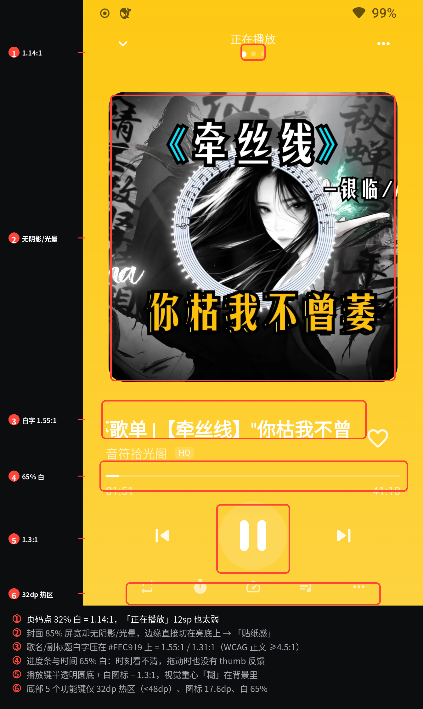
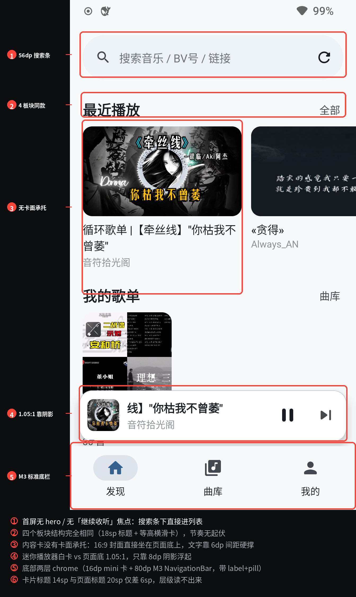
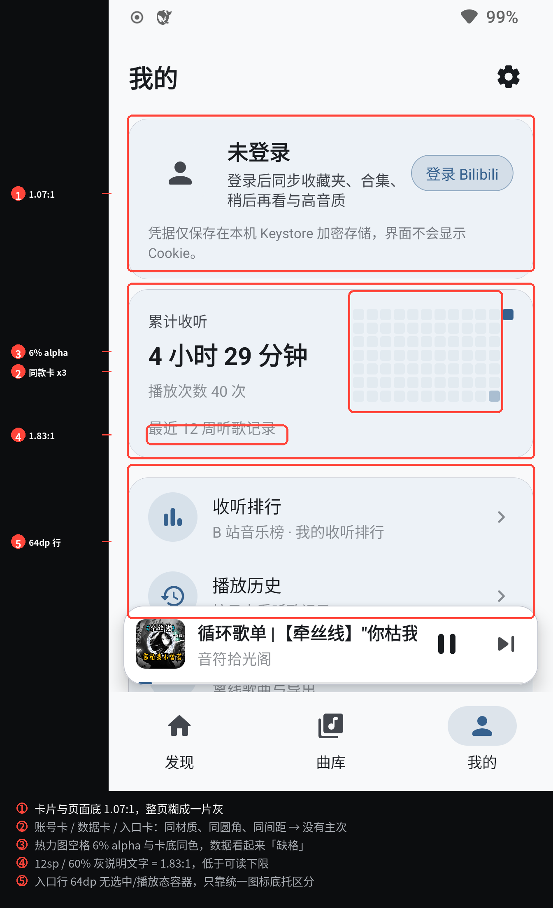
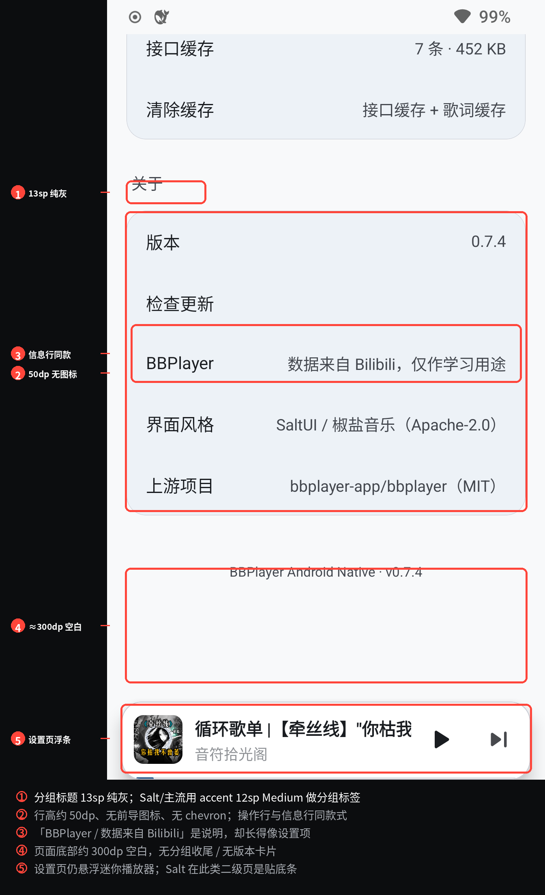

# BBPlayer 界面「高级感」审查与改造建议

> 审查对象：BBPlayer Android 原生版 v0.8.2（Kotlin + Jetpack Compose + SaltUI 2.8.6 + Material 3 1.4.0）
> 审查方式：只读代码审计 + 现有真机截图（1080×1920）像素采样 + 对标调研；**未修改任何 app 源码**
> 结论一句话：**你的 App 不缺功能、不缺组件，缺的是「可读性、材质、排版、动效、组件语言」这五件事被当成系统设计过。** 其中两处（播放页 scrim、材质与对比）改动最小、收益最大，1–2 天就能看出跨台阶的差别。
> 配套证据：原始逐维度审计与对标调研文档已随仓库清理归档（结论保留在本文）；标注图见第 2 节 `assets/`。

---

## 0. 先看这 3 处（如果只做三件事）

| 优先级 | 改什么 | 为什么立刻「贵」起来 | 位置 |
|---|---|---|---|
| 1 | **播放页背景三层化 + 亮度守卫**：模糊封面 → 其上叠 20%/45%/72% 黑 scrim；封面取色限制在低明度低饱和；白字对比断言 ≥4.5:1 | 现在白字压在亮黄上实测 **1.55:1**，文字不可读时任何布局都救不回质感 | `PlayerScreen.kt:235-258`、`AlbumWash.kt:56-74` |
| 2 | **材质与对比三件套**：次级文字改为可读的实色 token（去掉 `copy(alpha=0.6f)`）、卡片补 1dp hairline、纯白/深色主题补层级 | 卡片与页面底 1.07:1、描边 1.62:1、12sp 说明文字 1.83:1 → 整页「一层灰」 | `BbTheme.kt:78-126`、`DesignTokens.kt:62-67` |
| 3 | **底部 chrome 合并成一个 dock**：迷你播放器 + 导航收进同一个 28–32dp 圆角容器，导航去 label/去 M3 pill，改用图标填充态区分选中 | 现在「内容 + 16dp 迷你卡 + 80dp M3 NavigationBar」三层同色表面，是最典型的「Material 模板脸」 | `AppRoot.kt:239-290`、`BottomNavBar.kt:34-67`、`MiniPlayer.kt:74-105` |

对标依据：Apple Music / Spotify / TIDAL / QQ 音乐 / Salt Player 的做法详见第 3 节。

---

## 1. 为什么会有「不高级」的感觉：5 个根因

### 1.1 可读性失守（最致命，且是硬 bug）

播放页默认背景是 `GRADIENT`，代码意图是「渐变底 + 模糊封面 + 压暗」。实际分层顺序反了：

- `PlayerScreen.kt:235-258`：先画一个 `Brush.verticalGradient(base 0.95 → 0.55 → 黑 0.9)` 的 Box，**再**画一个全屏不透明的 `AsyncImage(...).blur(90.dp)`——后者把前者完全盖住；
- 同一个 `AsyncImage` 上的 `.background(Color.Black.copy(alpha = 0.25f))` 写在 `.blur()` 之后，按 Compose 绘制顺序它画在图片**下面**，同样不可见。

结果：整屏 = 未经压暗的模糊封面。截图 `05-player-playing.png` 实测底色 `#FEC919`，于是

| 元素 | 实测对比度 |
|---|---|
| 白色歌名 20sp | **1.55:1** |
| 65% 白副标题 / 时间（12sp） | **1.31:1** |
| 页码点 32% 白 | **1.14:1** |
| 播放键白图标 / 半透明白圆底 | **≈1.3:1** |

WCAG 正文要求 ≥4.5:1、大字/图形 ≥3:1。这一屏是「白字浮在亮黄上」的 Demo 观感，也是用户觉得「不高级」的第一来源。另外 `AlbumWash.kt:56-58` 还主动把取色提亮 1.15×、饱和 1.25×，等于往错误方向加码。

### 1.2 材质与层次缺失

- 浅色主题实际只有「页面底 + 卡片」两个色阶：`#F8F9FA` / `#EDF2F7`，比值 **1.07:1**；实测卡片描边 `#C3C6CF` 对底 **1.62:1**。卡片比页面底更暗、同为低彩度蓝灰，且**没有描边、没有阴影、没有第二级表面** → 读作「压下去的面板」而不是「浮起的内容」。
- 全工程 `Modifier.shadow` 只有 **1 处**（`MiniPlayer.kt:80`），`HorizontalDivider` **0 处**，`tonalElevation` 全为 0。
- 纯白（墨水屏）主题更极端：`BbTheme.kt:117-126` 令 `subBackground = background = #FFFFFF`，卡片 **1.00:1 完全消失**，`HomeScreen.kt:242-280` 专门写了一个 `needHairline` 补丁来救。
- 播放页大封面 85% 屏宽，却既无阴影也无光晕（`PlayerScreen.kt:683-699`），边缘直接切在亮底上，是典型的「贴纸感」。

> 说明：Spotify 的 `#121212 / #181818`（1.06:1）也差不多，但它靠**三级明度 + 明确边界**；Salt Player 靠 **50% 白 veil + hairline**。BBPlayer 两者都没有，只剩一块灰。

### 1.3 排版没有体系

`BbTheme.kt:78-83` 定义了 4 档字阶（main 14 / sub 12 / paragraph 14 / largeTitle 20），但实际代码里：

- **185 处硬编码 `fontSize`、13 种字号**（9 / 10 / 11 / 12 / 13 / 14 / 15 / 16 / 17 / 18 / 20 / 24 / 26sp），其中 11sp 出现 36 次、12sp 出现 48 次、13sp 出现 33 次；
- `fontFamily` **0 处**、`letterSpacing` **0 处**、`fontFeatureSettings` **0 处**（时长/进度每秒跳变，宽度会抖）；
- `lineHeight` 仅约 30 处手写，倍数 1.2–1.45 混用；
- 页面级标题有 5 种尺寸（16 / 17 / 20 / 24 / 26sp），「页面标题」不成为一个概念。

对标 Apple Music 的 6 级字阶、Spotify 用 900 字重 + 负字距做 display、Salt Player 用「12/16/24 + 字重/透明度」做层级——BBPlayer 是**用 1–2sp 的微差和 alpha 堆叠在撑层级**，中文小字又多，读起来就是「毛」。

### 1.4 动效与状态反馈缺失

全工程只有 **4 处** `animate*` 调用（封面缩放、歌词字号、歌词颜色、迷你条间距），`AnimatedContent` / `Crossfade` / `animateItem` / `updateTransition` / `spring` **全部为 0**：

- NavHost 未配转场（`AppRoot.kt:302-306`），16 个页面共用 navigation-compose 默认的 **700ms 淡入淡出**——这是手机上最「没有空间感」的转场；
- 迷你播放器 → 全屏播放器是 `if (showMiniPlayer)` 直接移除（`AppRoot.kt:258`），**没有共享元素**，封面不会从 40dp 连续长成 85% 屏宽——这是音乐 App 最重要、也最能体现「贵」的一个动作；
- 播放/暂停无图标切换动画、进度条位置直接跳、列表增删无 `animateItem`、tab 切换硬切；
- 迷你条标题用默认 `basicMarquee()`（`MiniPlayer.kt:127`），无边缘渐变——截图里能看到文字被硬切在左缘（「`线】`你枯我不曾萎」）。
- 触感 **0 处**（无 `performHapticFeedback`），收藏/切歌/拖动吸附只有颜色变化。

### 1.5 组件语言单一 + 底部 chrome 是 M3 模板脸

- 卡片几乎全是 `RoundedColumn`，按钮/筛选/确认/加减/重试几乎全是 `SaltPill`（约 28dp 高）。于是所有层级都是「同色圆角矩形」和「小胶囊」两种原语，材质同质。
- 底部是三层独立表面：内容 → 16dp 圆角迷你卡（带 8dp 阴影 + 0.5dp 描边）→ 80dp M3 `NavigationBar`（label + pill indicator）。三者圆角 0/16/50 混用、颜色相同、无边界关系——这是「装了 M3 组件的模板 App」的默认脸。
- 图标全 Material Rounded（约 70 处），尺寸被 `size * 0.55f` 算成 13/17.6/19.8/28.6dp 等非整数；2 处用 `Text("✓")` 当图标；全工程仅 1 处 `semantics`。
- 大量可点元素小于 48dp：底部功能行 32dp、顶栏 36dp、进度条触区 18dp、分组标题操作 ~24dp、清空 30dp、列表 more 40dp。

---

## 2. 证据：4 张标注图 + 实测数据

> 图注：左侧编号栏是问题定位与实测值，底部是说明。原图为 v0.8 系列真机 1080×1920 截图（0.8.1/0.8.2 仅修手势条 inset 与搜索，不影响结论）。

### 图 1 · 播放页：白字压在亮色封面取色上



1. 页码点 32% 白 = 1.14:1，「正在播放」12sp 也太弱；2. 封面 85% 屏宽无阴影/光晕 → 贴纸感；3. 白字 1.55:1；4. 进度与时间 65% 白，看不清且拖动无 thumb；5. 播放键半透明圆底 + 白图标 1.3:1；6. 底部 5 键 32dp 热区（<48dp）、图标 17.6dp。

### 图 2 · 发现页：没有 hero 与主次



1. 首屏无 hero / 无「继续收听」焦点，搜索条下直接进列表；2. 四个板块结构完全相同（18sp 标题 + 等高横滑卡）；3. 内容卡没有卡面承托；4. 迷你播放器白卡 vs 页面底 1.05:1，只靠阴影浮起；5. 底部两层 chrome；6. 卡片标题 14sp 与页面标题 20sp 仅差 6sp。

### 图 3 · 我的页：三张卡同材质同圆角同间距



1. 卡片与底 1.07:1，整页糊成一片灰；2. 账号卡 / 数据卡 / 入口卡没有主次；3. 热力图空格 6% alpha 与卡底同色，数据看起来「缺格」；4. 12sp/60% 灰说明文字 1.83:1；5. 入口行 64dp 无选中/播放态容器。

### 图 4 · 设置页：无图标、无分组色、无收尾



1. 分组标题 13sp 纯灰（Salt/主流用 accent 做分组标签）；2. 行高约 50dp、无前导图标、无 chevron；3. 说明行与操作行同款式；4. 底部约 300dp 空白；5. 二级页仍悬浮迷你播放器。

### 量化附录（可复现）

| 指标 | 实测 | 位置/命令 |
|---|---|---|
| `fontSize` 字面量 | **185 处 / 13 种**（9–26sp） | `grep -rn "fontSize" app/src/main/java` |
| `fontFamily` / `letterSpacing` / `tnum` | **0 / 0 / 0** | 同上 |
| `.dp` 字面量 | **569 处 / 52 种值**，仅 32.5% 落在 8 的倍数 | `grep -rho "[0-9.]\+\.dp"` |
| 圆角取值 | **12 种**（2/4/6/8/10/12/14/16/22/24/26/50） | `grep -rn RoundedCornerShape` |
| 阴影 / 分隔线 | **1 处 / 0 处** | `grep -rn "\.shadow(\|HorizontalDivider"` |
| 动效 | `animate*` 4 处；`AnimatedContent`/`Crossfade`/`animateItem` **0** | `grep -rn "animate\|Crossfade"` |
| 骨架屏 / 图片占位 | **0 / 0** | `States.kt`、`CoverImage.kt` |
| 触感 / `semantics` / `Role` | **0 / 1 处 / 0** | `grep -rn "performHapticFeedback\|semantics"` |

对比度实测（WCAG 2.1 相对亮度）：

| 前景 / 背景 | 比值 | 结论 |
|---|---|---|
| 播放页白字 / `#FEC919` | **1.55:1** | 严重不达标 |
| 播放页 65% 白 / 黄 | 1.31:1 | 副标题、时间不可读 |
| 播放页 32% 白 / 黄 | 1.14:1 | 页码点不可见 |
| 卡片 `#EDF2F7` / 页面底 `#F8F9FA` | **1.07:1** | 无边界线索 |
| 卡描边 `#C3C6CF` / 页面底 | 1.62:1 | 描边不可辨 |
| subText `#8C8C8C` / 底 | 3.19:1 | 12sp 不达标 |
| subText @60% / 底 | **1.83:1** | 大量说明文字不可读 |
| 纯白主题 卡 / 底 | **1.00:1** | 卡片消失 |
| 深色 卡 / 底 | 1.13:1 | 同样缺层次 |

---

## 3. 对标：高级感 App 做对了什么

> 原始调研（43 条来源）已归档；这里只留对 BBPlayer 有直接落点的部分。

| 维度 | 标杆怎么做（证据） | BBPlayer 落点 |
|---|---|---|
| **沉浸播放页** | Apple Music：封面主色模糊氛围 + 大封面 + 超大高对比控件，歌词活跃行 24pt/800，邻行 0.55/0.35；Salt Player：重模糊封面 + 白字 + 2dp 进度线（时间在下方）；QQ音乐：封面主色二次加工出双层「魔法色」，mini bar→播放页→歌词页色彩连续 | 保留现有 Pager 结构，背景改三层（模糊降采样图 / 双色渐变 / 固定 scrim），文字对比断言 ≥4.5:1，封面加 24dp 环境阴影 + 同图光晕 |
| **字阶** | Apple Music 六级 34/28/22/17/15/12；Spotify display 900 重、行高 1.05、负字距；M3 五角色 × 三尺寸；Salt 则刻意只用 12/16/24 + 字重/透明度 | 扩到 6–7 档并**消灭页面里的字号字面量**；中文行高 1.25–1.5；时间/计数用等宽数字 `tnum` |
| **色彩** | TIDAL 品牌层零彩色 accent，彩色全部交给封面；Spotify 近黑 `#121212` 三层明度、几乎无阴影；Apple 不把封面色扩散到浏览 chrome | Material You 动态色**降级为 accent**（只用于选中/播放行/开关），中性表面固定；浏览页永不随封面变色，封面色只进播放链路 |
| **层次** | M3：层级靠色调、阴影克制；TIDAL：`#2a2a2a` hairline、无阴影；Apple Liquid Glass 只允许用于「功能层」（导航、mini player），禁止进内容层 | 选一派并统一：卡片 = veil/白面 + 1dp hairline（+ 必要时极轻阴影）；只有封面、迷你条、dock、Sheet 用阴影 |
| **间距/密度** | M3 8dp 基线；Apple 屏边 16 / 区块 28 / 卡内 16；TIDAL 4/8/16/24/32/48/64 | 建 spacing token，禁止 6/10/14/18 等魔数（当前 569 处 dp 里大头全是这些） |
| **圆角** | M3 尺度 0/4/8/12/16/20/28/32/48；Apple 封面 8–10 / 卡片 10 / Sheet 24；QQ 音乐 2024 主动**减小**圆角让图片更完整 | 收敛为 8（缩略图）/12（卡与封面）/16（hero 大图）/28（Sheet 顶角）/full（pill），同层必须同值 |
| **动效** | M3 Expressive 弹簧物理 + 三档时长（fast/default/slow）；Compose `SharedTransitionLayout` 做共享元素；Apple 把「mini → 播放页」做成封面连续 morph | 统一 120/220/320ms + `FastOutSlowIn`；mini→播放页封面 sharedElement；tab `Crossfade(180ms)`；列表 `animateItem` |
| **空/加载/错误** | Apple HIG：占位要保留原尺寸/密度，不用装饰插画替代内容；M3 Expressive loading 用形状 morph；汽水音乐「先给声音、后补信息」 | 首屏骨架屏（保住版式）+ 图片 crossfade/error 占位 + 内联错误卡片；空态给「主张 + 主按钮」 |
| **图标** | M3 Material Symbols 一套风格，可调 weight/fill/optical size；Salt 在设置/菜单里用「彩色语义图标」做记忆点 | 一套图标 + 三档尺寸 16/20/24 + 48dp 热区；选中态用 fill 区分，不再 `size*0.55f`；删掉 `Text("✓")` |
| **触感** | Apple HIG 触感三类（notification / impact / selection），只给离散事件、与动效同帧、可关闭 | 收藏 Toggle、进度吸附 SegmentTick、成功 Confirm；播放/暂停与滚动不震 |

**明确不要抄**：Material You 全屏动态色泛滥、低对比「水洗」卡片、16dp 圆角 + 大阴影一刀切、纯黑 `#000` 浏览底、整 App 随每首歌换主题色、照搬汽水音乐的信息流。

---

## 4. 优化清单（按性价比排序，含验收标准）

### P0 · 1–2 天，肉眼可见的提升（建议先单独出一个版本）

| # | 问题 | 改法（具体到数值/API） | 验收 |
|---|---|---|---|
| P0-1 | 播放页白字 1.55:1；scrim 被封面盖住 | 顺序改为「`AsyncImage.blur(90.dp)` → 其上叠 `Box(Brush.verticalGradient(Black 0.20 → 0.45 → 0.72))`」；`CoverWash` 输出限制 `S ≤ 0.55`、`V 0.22–0.45`；`SOLID` 模式同样过亮度守卫（luminance > 0.45 则压暗） | 用截图像素脚本断言：白字对合成背景 ≥4.5:1；亮黄/亮绿/深黑封面各一张截图 |
| P0-2 | 状态栏图标不随播放页背景 | `MainActivity` 的 `SystemBarStyle.auto` 之外，播放页 `DisposableEffect` 内按 wash 亮度设置 `isAppearanceLightStatusBars` | 深/浅 wash 各一张：状态栏图标都清晰 |
| P0-3 | 次级文字不可读（31 处 `subText.copy(alpha)`） | 新增 `subText` 实色 token（如 `#5F6368`，对白 6.0:1）；**12sp 禁止再乘 alpha**；层级改用字号/字重，不用透明度 | grep 断言：`subText.copy(alpha` 归零；抽查 3 屏说明文字对比 ≥4.5:1 |
| P0-4 | 卡片无边界、纯白模式卡片消失 | `surface` 统一「白面/veil + 1dp hairline（`#0000001F`）」；`stroke` 提为 token；删除 `needHairline` 补丁；纯白主题给 `stroke` 固定值 | 浅色/深色/纯白三套主题截图，卡片边界肉眼可辨；对比度脚本记录 |
| P0-5 | 播放页弹层固定 `#262626`、38 处 `Color.White` 硬编码 | 弹层色全部改用 theme token；纯白模式弹层跟随浅色 | 纯白主题打开「速度/定时/更多」不出现深灰弹层 |
| P0-6 | <48dp 热区 | 底部功能行 32→48、顶栏 36→48、进度条触区 18→44、`SectionHeader` 操作、清空、`TrackRow` more 全部 `sizeIn(minWidth=48.dp, minHeight=48.dp)` | UI 自动化/手工点按 6 个入口一次命中 |

### P1 · 3–5 天，建立「系统感」

| # | 改什么 | 关键数值 |
|---|---|---|
| P1-1 | **字阶 7 档 + 行高 + tnum** | display 28/34、title 22/28、section 18/24、body 15/22、label 13/18、caption 12/17、micro 11/16（sp/sp，行高）；时间/计数 `fontFeatureSettings = "tnum"`；页面内 `fontSize =` 字面量清零 |
| P1-2 | **间距 / 圆角 / 图标 token 收敛** | spacing 4/8/12/16/20/24/32/48；圆角 8/12/16/28/full；图标 16/20/24 + 48dp 热区；删掉 6/10/14/18/22/26 与 `size*0.55f` |
| P1-3 | **底部 dock 合并** | 一个 28–32dp 圆角容器：上 64dp 迷你行 + 下 56dp icon-only 导航；选中 `text` 100%、未选中 `subText 45%`，去掉 M3 pill 与 label；`navigationBarsPadding` 在容器内 |
| P1-4 | **深度体系二选一并统一** | 卡片：veil/白面 + hairline、不投影；封面：24dp 环境阴影 + 同图光晕；迷你条/dock：16dp、10% 阴影 + 1dp 顶边 hairline |
| P1-5 | **空/加载/错误态 + 图片占位** | 骨架屏（行高按真实 64dp、12dp 圆角、alpha 呼吸）；`AsyncImage(placeholder/error/crossfade 200ms)`；空态 = 120dp 单色符号 + 17sp/600 标题 + 13sp 说明 + 48dp 主按钮；错误内联卡片（不打断布局） |

### P2 · 1–2 周，把「高级」拉满

- **P2-1 动效体系**：转场 220ms `fadeThrough` / 二级页 `slideInHorizontally`；`SharedTransitionLayout` + `sharedElement` 做 mini→播放页封面 morph；播放键 `AnimatedContent`；进度 `animateFloatAsState(250ms, LinearEasing)`；列表 `animateItem`；`basicMarquee(edgeFade = true)` 或自绘两端渐隐 + 静止 3s 后再滚。
- **P2-2 发现页 hero**：顶部「继续收听」16:9 大卡（模糊封面 + 渐变 + 22sp/Bold 标题 + 48dp 播放键）；模块高度分 3 档（hero 200 / rail 160 / list 72），区块间距 24/32 交替。
- **P2-3 设置页**：分组标签改 accent 12sp/Medium；行高 56、加 24dp 前导图标（highlight 12% 圆底）；危险项（退出登录/删除下载）用 error 色；底部补版本卡片收尾。
- **P2-4 我的页**：身份 + 累计收听合并为 hero 卡（22sp 数字 + 渐变/封面底）；热力图空格改「有边框的空格」，数据可信度立刻回来。
- **P2-5 触感**：`Confirm` / `Toggle` / `SegmentTick` 三件套，设置里可关。
- **P2-6 图标**：Material Symbols Rounded（或自绘 2dp 线条的播放/暂停/上下首），选中态 fill，删除 `Text("✓")`。

---

## 5. 建议的 v9 设计 token（可直接照抄）

```kotlin
// 字阶（字号 / 行高，中文行高 1.25–1.5）
Display  28/34 Bold      // 详情页大标题
Title    22/28 SemiBold  // 页面标题
Section  18/24 SemiBold  // 区块标题
Body     15/22 Regular   // 正文/列表标题（列表标题可 Medium）
Label    13/18 Medium    // 按钮/值/辅助
Caption  12/17 Regular   // meta
Micro    11/16 Medium    // 徽标（≥10sp）
// 时间、时长、计数：fontFeatureSettings = "tnum"

// 间距
Xs 4 · Sm 8 · Md 12 · Lg 16 · Xl 20 · Xxl 24 · Section 32 · Hero 48
// 页面 gutter 16dp（平板 24dp）；组标题 top 24 / bottom 8；区块之间 24–32

// 圆角
8  缩略图 / 徽标
12 内容卡 / 16:9 封面
16 播放页大封面 / hero
28 Sheet 顶角（仅上两角）
CircleShape 头像 / 圆形按钮

// 色彩（浅色）
bg #F2F3F5 · surface #FFFFFF · stroke #0000001F
text #17181A (17.8:1) · subText #5F6368 (6.0:1) · accent #0470E6
// 色彩（深色）
bg #101214 · surface #17191C · surfaceHigh #1F2328 · stroke #FFFFFF1A
text #ECEFF3 (16.3:1) · subText #A5ABB3 (8.1:1) · accent #5AA9FF

// 播放页
wash: S ≤ 0.55, V 0.22–0.45（取色后夹紧）
scrim: Black 0.20 → 0.45 → 0.72（顶→中→底）
断言: 白字对合成背景 ≥ 4.5:1，否则继续压暗

// 动效
fast 120ms · base 220ms · slow 320ms
easing FastOutSlowIn；展开类用 spring(dampingRatio = 0.8f, stiffness = Spring.StiffnessMediumLow)
页面 tab → fadeThrough(200)；push → slideInHorizontally(1/8 宽)；封面 → sharedElement

// 图标
16 行内 · 20 默认 · 24 控制；所有可点元素 48dp 热区；一套图标库，选中态 fill
```

> 数字说明：表中对比度均已用 WCAG 相对亮度公式核算（浅色 subText 6.0:1、深色 subText 8.1:1）；`accent #0470E6` 对白 4.7:1，可用于 ≥14sp 的强调文字，12sp 强调请用更深的 `#0357B8`。

---

## 6. 实施路线与验收包

| 迭代 | 范围 | 验收物 |
|---|---|---|
| v9.0（1–2 天） | P0-1 ~ P0-6 | 亮/暗/纯白 × 发现/播放/我的/设置 12 张截图；对比度断言脚本输出；`app-debug.apk`；一主题一 commit |
| v9.1（3–5 天） | P1-1 ~ P1-5 | 字号/圆角/dp 字面量 grep 报告（页面层应为 0）；三主题截图；空态/骨架/错误态各 2 张 |
| v9.2（1–2 周） | P2-1 ~ P2-6 | 转场/共享元素录屏（或关键帧截图）；发现页 hero 前后对比；设置页前后对比；触感设备实测说明 |

**风险与约束**

- 动态取色降级为 accent 会改变老用户观感——建议保留「动态取色」开关，但只作用于 accent 与选中态，不接管中性表面。
- 全屏 `blur(90.dp)` 在中低端机有掉帧风险（API 31+ 才生效）：改用降采样小图 + 低半径 blur 或预生成模糊图，并保留纯色/渐变兜底。
- `SharedTransitionLayout` 与现有 `HorizontalPager`/全屏 overlay 结构叠加需小范围重构，建议单独一个 commit，便于回滚。
- 不要一次全改：先出 v9.0 的 P0，拿到真机对比图再决定 P1/P2 顺序。

---

## 7. 参考来源（精选）

**规范/官方文档**

- [Material 3 · Applying type](https://m3.material.io/styles/typography/applying-type) / [Shape & corner radius](https://m3.material.io/styles/shape/corner-radius-scale) / [Elevation](https://m3.material.io/styles/elevation) / [Motion specs](https://m3.material.io/styles/motion/overview/specs) / [Icons](https://m3.material.io/styles/icons/overview)
- [Apple HIG · Materials](https://developer.apple.com/design/human-interface-guidelines/materials) / [Typography](https://developer.apple.com/design/human-interface-guidelines/typography) / [Playing haptics](https://developer.apple.com/design/human-interface-guidelines/playing-haptics)
- [Compose · Blur](https://developer.android.com/develop/ui/compose/graphics/blur/overview) / [Shared elements](https://developer.android.com/develop/ui/compose/animation/shared-elements)
- [SaltUI（Salt Player 设计系统源码）](https://github.com/Moriafly/SaltUI)

**标杆 App 拆解**

- Apple Music：[iOS 规格拆解（含 token）](https://code.jiangshu.ai/awesome-design-html/assets/ios/design.apple-music-ios.html)
- Spotify：[设计 token 拆解](https://raw.githubusercontent.com/opencoworkai/open-codesign/ca833517a009bb194b95c7620005a8dc8b57bf88/apps/desktop/resources/templates/brand-refs/spotify/DESIGN.md)
- TIDAL：[设计系统拆解](https://www.shadcn.io/design/tidal)
- YouTube Music：[2024 艺人页改版](https://www.androidpolice.com/youtube-music-artist-page-redesign/)
- QQ 音乐：[2024 年度版本设计总结](https://www.uisdc.com/qqmusic-2024)
- Salt Player：[Release notes](https://github.com/Moriafly/SaltPlayerSource/releases)、仓库内 recon：[saltplayer-design.md](../.ai/recon/saltplayer-design.md)

---

## 8. 证据文件

| 文件 | 内容 |
|---|---|
| [.ai/ui-polish/AUDIT.md](../.ai/ui-polish/AUDIT.md) | 216 行逐维度审计：10 个维度 × 现象/证据/原因/改法 + 量化附录 A–F |
| [.ai/ui-polish/REFERENCES.md](../.ai/ui-polish/REFERENCES.md) | 132 行对标调研，43 条已校验来源 |
| [docs/ui-review/01-player.png](assets/01-player.png) | 播放页 6 处标注 |
| [docs/ui-review/02-discover.png](assets/02-discover.png) | 发现页 5 处标注 |
| [docs/ui-review/03-profile.png](assets/03-profile.png) | 我的页 5 处标注 |
| [docs/ui-review/04-settings.png](assets/04-settings.png) | 设置页 5 处标注 |
| [.ai/ui-polish/annotate.py](../.ai/ui-polish/annotate.py) | 标注图生成脚本（可复现） |

> 本次审查为只读：`git status` 仅新增 `.ai/ui-polish/` 与 `docs/ui-review/`，`app/`、`core/`、`data/`、`playback/`、`lyrics/` 均未改动。
